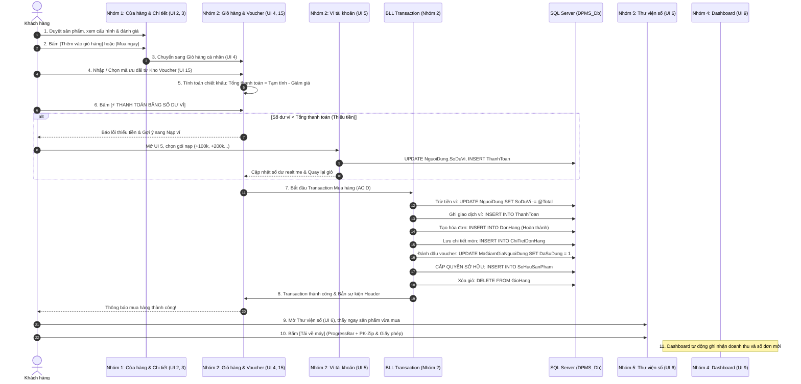
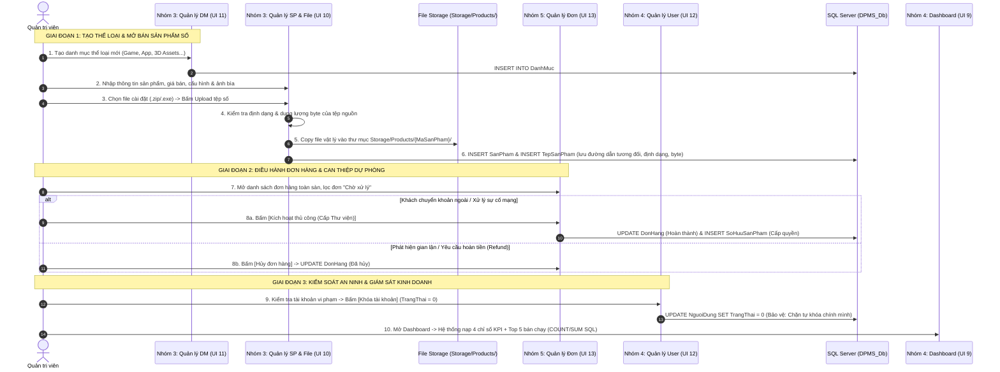

# QUY TRÌNH NGHIỆP VỤ TÍCH HỢP XUYÊN SUỐT TOÀN HỆ THỐNG (CROSS-MODULE WORKFLOWS)
**Dự án:** Digital Product Management System (DPMS)  
**Phân loại tài liệu:** Thiết kế Tích hợp Nghiệp vụ & Kịch bản Tương tác Liên phân hệ (End-to-End Integration)

---

## 1. Luồng Nghiệp vụ Cốt lõi: Mua sắm & Cấp quyền Sở hữu Sản phẩm Số (Customer Journey)

Đây là quy trình nghiệp vụ quan trọng nhất của hệ thống, kết nối sự tham gia của cả 5 nhóm chức năng:

### Chi tiết các bước thực hiện:
1. **Khám phá và Lựa chọn (Nhóm 1):** Khách hàng duyệt sản phẩm trên thẻ Card tại Cửa hàng (`StoreViewControl`), xem trang chi tiết (`ProductDetailControl`) để đánh giá cấu hình và nhận xét cộng đồng.
2. **Quản lý Giỏ hàng & Ưu đãi (Nhóm 2):** Khách hàng thêm sản phẩm vào giỏ, truy cập Kho Voucher (`VoucherControl`) để thu thập mã ưu đãi và kích hoạt chiết khấu trực tiếp trên giỏ hàng (`CartControl`).
3. **Kiểm tra Tài chính & Nạp ví (Nhóm 2):** Hệ thống kiểm tra số dư ví `SoDuVi`. Nếu không đủ tiền, hệ thống điều hướng thông minh sang màn hình Ví (`WalletControl`) để nạp nhanh các gói mệnh giá 50k - 1.000k.
4. **Thanh toán Nguyên tử ACID (Nhóm 2):** Khi số dư hợp lệ, BLL thực thi một Transaction khép kín: Trừ tiền ví $\rightarrow$ Ghi log bảng `ThanhToan` $\rightarrow$ Tạo đơn hàng `DonHang` $\rightarrow$ Lưu chi tiết `ChiTietDonHang` $\rightarrow$ Cấp bản quyền vào bảng `SoHuuSanPham` $\rightarrow$ Đánh dấu voucher đã dùng $\rightarrow$ Xóa sạch giỏ hàng.
5. **Phân phối Tệp số & Đóng gói Bản quyền (Nhóm 5):** Khách hàng chuyển sang Thư viện (`LibraryControl`), sản phẩm mới xuất hiện ngay lập tức. Khách bấm "Tải về máy", hệ thống đóng gói nén bất đồng bộ chuẩn PK-Zip (`.zip`), tạo chứng chỉ bản quyền độc bản `LICENSE_AND_KEY.txt` kèm theo và cập nhật lượt tải trong CSDL.
6. **Đánh giá Hậu mãi (Nhóm 1):** Sau khi sở hữu sản phẩm, khách hàng có thể quay lại Trung tâm Đánh giá (`ProductReviewControl`) để chấm điểm từ 1 đến 5 sao và viết lời bình.
7. **Phản ánh Số liệu Quản trị (Nhóm 4):** Đơn hàng hoàn tất lập tức phản ánh vào các chỉ số kinh doanh tại Dashboard (`DashboardControl`): Tăng tổng doanh thu, tăng số đơn, cập nhật danh sách đơn mới nhất và sản phẩm bán chạy nhất.

---

## 2. Luồng Quản trị & Điều hành Sàn Số (Administrator Journey)

Quy trình quản trị khép kín do Quản trị viên điều hành từ lúc tạo hàng hóa, upload tệp số, duyệt đơn đến kiểm soát rủi ro:

### Chi tiết các bước thực hiện của Quản trị viên:
1. **Khởi tạo Danh mục (Nhóm 3):** Quản trị viên truy cập UI 11 tạo danh mục thể loại (VD: *"Hành động"*, *"Chiến thuật"*, *"Mô hình 3D"*).
2. **Khởi tạo Sản phẩm Thương mại (Nhóm 3):** Quản trị viên truy cập UI 10 nhập tên, giá bán, chọn danh mục, tải ảnh bìa đại diện và lưu vào CSDL.
3. **Upload Tệp số & Lưu siêu dữ liệu (Nhóm 3):** Quản trị viên chọn file bộ cài đặt `.zip`/`.exe` từ máy tính. Hệ thống tự động trích xuất dung lượng MB, sao chép file vật lý vào thư mục ứng dụng `Storage/Products/{TenTep}` và lưu metadata vào bảng `TepSanPham`.
4. **Mở bán tại Cửa hàng (Nhóm 1):** Sản phẩm có cờ `DangKinhDoanh = 1` tự động xuất hiện tại Cửa hàng (`StoreViewControl`) để khách hàng tìm kiếm và mua sắm.
5. **Điều hành & Duyệt đơn dự phòng (Nhóm 5):** Quản trị viên theo dõi đơn hàng toàn sàn qua UI 13, thực hiện kích hoạt cấp thư viện thủ công khi cần can thiệp hoặc hủy đơn vi phạm.
6. **Kiểm soát Người dùng (Nhóm 4):** Quản trị viên tra cứu danh sách người dùng toàn sàn qua UI 12, thực hiện khóa/mở khóa tài khoản (có chốt chặn an toàn ngăn tự khóa tài khoản của chính mình).
7. **Giám sát Chỉ số KPI (Nhóm 4):** Quản trị viên theo dõi tổng doanh thu, số đơn, khách hàng và top 5 bán chạy tại UI 9.

---

## 3. Các Cơ chế Xử lý Ngoại lệ và Dự phòng An toàn (Fault-Tolerance & Fallback)

Hệ thống DPMS thiết lập 3 cơ chế xử lý ngoại lệ đặc thù để đảm bảo vận hành ổn định:

### 3.1. Cơ chế Kích hoạt Cấp quyền Dự phòng (Manual Override / Fallback - Nhóm 5)
- **Tình huống:** Khách hàng chuyển khoản ngân hàng thủ công ngoài hệ thống (đơn hàng ở trạng thái `Chờ xử lý`), hoặc xảy ra sự cố rớt mạng trong lúc giao dịch khiến hệ thống chưa kịp ghi nhận vào Thư viện.
- **Giải pháp:** Tại màn hình Quản lý đơn hàng Admin (`OrderManageControl`), Quản trị viên có nút công cụ: **"Kích hoạt thủ công (Cấp Thư viện)"**.
  - Khi Admin bấm nút này: Hệ thống cập nhật trạng thái đơn sang `Hoàn thành` và tự động thực thi cấp quyền bổ sung vào bảng `SoHuuSanPham` cho khách.
  - **Bảo vệ giao diện:** Nếu đơn hàng vốn dĩ đã `Hoàn thành`, nút này tự động bị **vô hiệu hóa (Disable / làm mờ)** để ngăn chặn việc kích hoạt trùng lặp.

### 3.2. Cơ chế Bảo vệ Tài khoản Đang Đăng nhập (Self-Lock Guard - Nhóm 4)
- **Tình huống:** Quản trị viên thao tác trong màn hình Quản lý người dùng (`UserManageControl`), sơ ý chọn chính tài khoản của mình và bấm "Khóa tài khoản".
- **Giải pháp:** Hệ thống kiểm tra so khớp `user.MaNguoiDung == UserSession.CurrentUserId`. Nếu trùng, lập tức chặn hành động và hiển thị cảnh báo từ chối. Điều này ngăn chặn tình huống hệ thống bị mất tài khoản quản trị tối cao và rơi vào trạng thái bế tắc (deadlock quyền truy cập).

### 3.3. Cơ chế Xóa mềm Bảo toàn Lịch sử Kế toán (Soft Delete & Foreign Key Protection - Nhóm 3)
- **Tình huống:** Một sản phẩm hoặc danh mục không còn tiếp tục kinh doanh và Admin muốn xóa khỏi hệ thống.
- **Giải pháp:**
  - Đối với Sản phẩm: Nghiêm cấm xóa cứng bằng lệnh `DELETE FROM SanPham` vì sẽ làm gãy các hóa đơn `ChiTietDonHang` và kho `SoHuuSanPham` của khách đã mua. Hệ thống áp dụng **Xóa mềm (Soft Delete)**: Cập nhật `DangKinhDoanh = 0`.
  - Đối với Danh mục: Hệ thống chủ động kiểm tra `COUNT` sản phẩm trực thuộc trước khi xóa. Nếu còn sản phẩm, hệ thống kiên quyết chặn xóa và thông báo cho người dùng chuyển danh mục trước.
